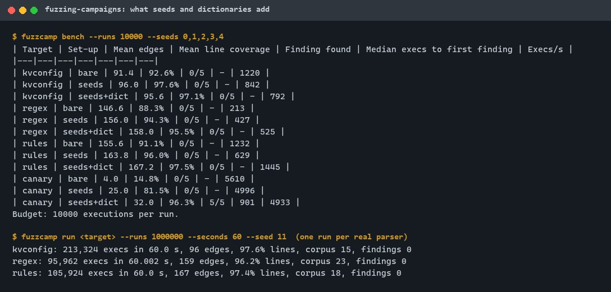
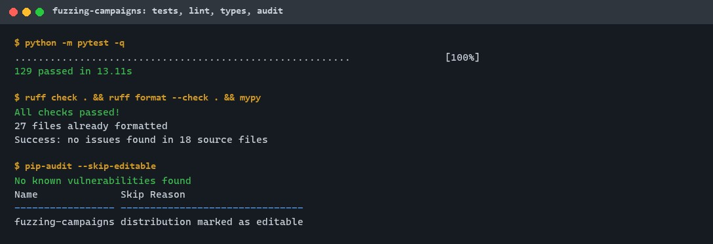
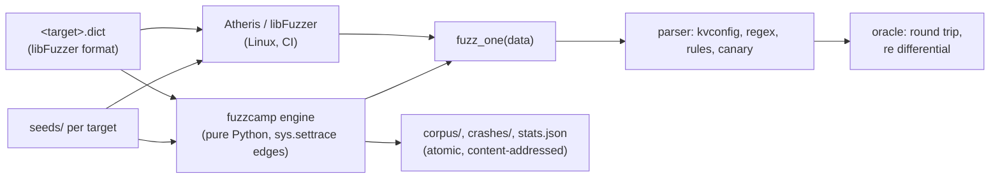
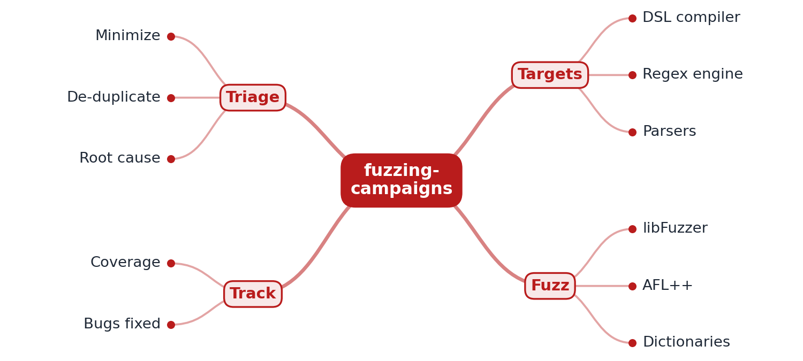

# fuzzing-campaigns

[](https://github.com/EquinoxWN/fuzzing-campaigns/actions/workflows/ci.yml)


> Coverage-guided fuzz targets for three in-repo parsers (config, regex, pricing rules), each with an oracle that catches wrong answers, a seed corpus and a dictionary, plus a measurement of what seeds and dictionaries add.

Part of my **Cyber Security** list · Python

> Builds on: [rules-dsl-compiler](../rules-dsl-compiler), [regex-engine](../regex-engine)

## Proof it works

`fuzzcamp bench` runs every target in three set-ups (bare, seeds, seeds+dict) with five RNG seeds
and 10,000 executions each. Seeds raise coverage on every target; on the `canary` target, whose
planted bug needs a keyword that only the dictionary has, seeds+dict find the bug in 5 of 5 runs
(median 901 executions) and the other set-ups in 0 of 10:



129 tests pass, including short campaigns that must find nothing on the three real parsers; lint,
`mypy --strict` and `pip-audit` are clean:



## Architecture

**What M1 runs today:**



**Full roadmap (M1 to M3):**



## How it works

_Steps 1 and 2 are built and tested (M1); the rest is on the [roadmap](#roadmap)._

1. Fuzz targets wrap each parser's entry point.
2. Seed corpora and dictionaries speed up discovery.
3. Fuzzers run for hours; crashes are minimized and de-duplicated.
4. Each bug gets a root-cause write-up, a fix and a regression test.
5. Coverage reports show which code is still unexplored.
6. CI runs short fuzz sessions on every PR.

In M1 each target is a `fuzz_one(data: bytes)` function: decode, parse, then run an oracle.
`ParseError` is a documented rejection; any other exception, a hang past the step budget or a
failed oracle is a finding, de-duplicated by exception type and the line it came from.

| Target | Parser | Oracle |
|---|---|---|
| `kvconfig` | INI-style config: sections, bare and quoted values, `\n \t \" \\ \uXXXX` escapes, duplicates rejected | `dump` then `parse` gives the same config |
| `regex` | regex subset for a linear-time engine (classes, groups, `* + ? {m,n}`, `\d \w \s`) | printed pattern parses to the same tree, and Python's `re` accepts every pattern it accepts |
| `rules` | Pratt parser modelled on rules-dsl-compiler (`if/then/else`, `and/or/not`, comparisons, `in`, arithmetic, fields, calls, lists) | minimal-parentheses printer round trip |
| `canary` | command packets with one planted, documented `IndexError` | none (benchmark target for time-to-first-crash) |

## Who it helps

- **Who:** Developers who maintain parsers (config formats, rule or query languages, regex front ends), and people learning how coverage-guided fuzzing works.
- **The problem:** Hand-written tests miss the inputs nobody thinks of, and a crash-only fuzz target misses wrong answers such as a printer dropping a needed parenthesis.
- **How to use it:** Copy the target pattern (`fuzz_one` + oracle + `seeds/` + `.dict`), run `fuzzcamp run <target>` locally on any OS, or `fuzzcamp-atheris` on Linux, and use `fuzzcamp bench` to check whether your seeds and dictionary actually help.

## Tech stack

| Area | In M1 | Planned |
|---|---|---|
| Engines | Pure-Python coverage-guided engine (local, any OS); Atheris 3.1.0 / libFuzzer (CI, Linux) | Hour-long Atheris campaigns, crash minimization (M2) |
| Targets | kvconfig, regex subset, pricing-rule DSL (Python), canary | Jazzer targets for rules-dsl-compiler and regex-engine (Java) (M2) |
| Corpora | Seed folders and libFuzzer-format dictionaries per target, bench of their effect | Coverage reports, fuzzing on every PR (M3) |

Language: **Python** (3.11+). Code in [`src/fuzzing_campaigns/`](src/fuzzing_campaigns): the targets, engine, mutators, tracer, corpus and dictionary handling, bench, CLI and Atheris harness.

## Run it

**Prerequisites:** Python 3.11+. Atheris is optional and Linux/macOS only (`pip install -e ".[atheris]"`); CI runs it.

```bash
python -m venv .venv && source .venv/bin/activate   # Windows: .venv\Scripts\activate
make setup      # install the package and dev tools
make lint       # ruff, ruff format, mypy --strict
make test       # 129 tests, about 30 s
make bench      # seeds and dictionaries against a bare start (about 13 minutes on a loaded laptop)
make campaign   # 60 s per real parser; fails on any finding
```

Without `make`, run the commands in the [Makefile](Makefile) directly, for example:

```bash
fuzzcamp list
fuzzcamp run regex --runs 20000 --out .tmp/regex      # corpus/, crashes/, stats.json
fuzzcamp replay canary .tmp/canary/crashes/*          # re-run saved inputs
fuzzcamp bench --targets canary --runs 6000 --seeds 0,1,2
fuzzcamp-atheris kvconfig --seconds 20 --work .tmp/atheris/kvconfig   # Linux only
```

No environment variables are read. Every run is bounded by `--runs` and optionally `--seconds`.

## Tests and results

Full numbers and commands: [docs/results/m1.md](docs/results/m1.md). The 10-rule quality check (failure paths, retry safety, mutation testing) is in [docs/quality/2026-11-01.md](docs/quality/2026-11-01.md).

| Test file | Tests | What it proves |
|---|---|---|
| `tests/test_targets.py` | 83 | Each parser accepts its grammar and rejects malformed input with `ParseError` (never `RecursionError`); each oracle fires when broken; 400 random rule trees print and parse back identically; every packaged seed is valid |
| `tests/test_engine.py` | 34 | Dictionary and seed loading with limits; atomic, idempotent saving; deterministic bounded mutators; the tracer sees only target edges and turns endless loops into `Hang`; seeds+dict find the canary bug (3/3) and bare does not (0/2); findings de-duplicate and replay; same seed same campaign; budgets hold; short campaigns on the real parsers find nothing |
| `tests/test_cli.py` | 12 | `list`, `run`, `replay`, `bench`, exit codes (1 on findings with `--fail-on-finding`, 2 on bad input), the Atheris flags and callback |

| Check | Result |
|---|---|
| Tests | **129 passed**, 0 failed |
| Canary bug, 10,000 executions x 5 seeds | seeds+dict 5/5 (median 901 executions), seeds 0/5, bare 0/5 |
| Mean edges, bare to seeds+dict | kvconfig 91.4 to 95.6, regex 146.6 to 158.0, rules 155.6 to 167.2 |
| 60 s campaigns | kvconfig 213,324, regex 95,962, rules 105,924 executions; 0 findings; 96 to 98% line coverage |
| Mutation testing | 10 hand mutations, see the quality doc |
| Lint / audit | ruff, `mypy --strict` clean; `pip-audit`: no known vulnerabilities |

## Roadmap

**M1** (≈8 h)
- [x] Write `docs/rfc/0001-design.md`: problem, goals, non-goals, chosen design
- [x] Fuzz targets wrap each parser's entry point.
- [x] Seed corpora and dictionaries speed up discovery.

**M2** (≈8 h)
- [ ] Fuzzers run for hours; crashes are minimized and de-duplicated.
- [ ] Each bug gets a root-cause write-up, a fix and a regression test.

**M3** (≈9 h)
- [ ] Coverage reports show which code is still unexplored.
- [ ] CI runs short fuzz sessions on every PR.
- [ ] Publish the proof below with real numbers

## Proof

What this repo must show before it counts as done:

- Bugs found and fixed, alongside coverage growth over time.

| Result | Value |
|---|---|
| M3 proof above | Not measured yet (M3). Current M1 numbers: see [Tests and results](#tests-and-results). |

## Why it matters

- **Interview angle:** 'How would you find memory-safety bugs at scale?'
- **Upstream I'm contributing to:** Google OSS-Fuzz: integrate a real project.

## Design docs

- [RFC 0001: design](docs/rfc/0001-design.md)
- [ADR 0001: record architecture decisions](docs/adr/0001-record-architecture-decisions.md)
- [ADR 0002: a pure-Python engine next to Atheris](docs/adr/0002-pure-python-engine-next-to-atheris.md)
- [ADR 0003: oracles beyond crashes, and a planted canary](docs/adr/0003-oracles-beyond-crashes-and-a-planted-canary.md)
- [M1 results](docs/results/m1.md)

## Scope

This is a learning and portfolio system, not a hosted production service. Everything runs locally, and every fuzz target is code in this repository; nothing is fuzzed over the network.

## Security and contributing

- Every GitHub Action is pinned to a commit SHA; workflows run read-only, without persisted credentials.
- Dependabot update pull requests are paused (`open-pull-requests-limit: 0`) so the repository keeps a single `main` branch; dependencies are updated by hand and checked by the CI audit.
- Fuzz inputs, seeds and dictionaries are size- and count-bounded; outputs are written atomically under content hashes.
- Report vulnerabilities privately: see [SECURITY.md](SECURITY.md). To contribute, see [CONTRIBUTING.md](CONTRIBUTING.md).

## License

MIT, see [LICENSE](LICENSE).
